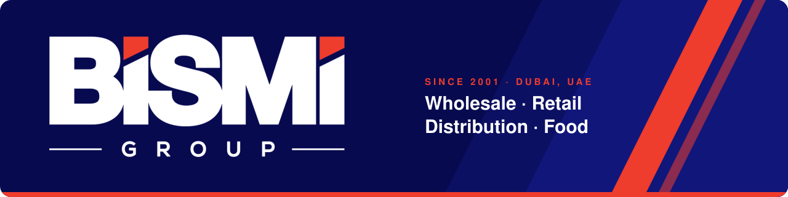

  

  
  
  

<h2 align="center">Welcome to Bismi Group on GitHub</h2>

  Headquartered in Dubai and trusted across the UAE since 2001, Bismi Group is a leading wholesale distributor and FMCG supplier. 
  This is where our technology team builds the systems that keep our stores, warehouses and deliveries running.

 

## 🏢 Our businesses

| | Division | What we do |
| :---: | --- | --- |
| 🛒 | **Wholesale** | FMCG food, beverages and non-food supply for retailers, groceries, hotels and restaurants |
| 🏬 | **Retail** | Bismi Wholesale outlets across Dubai, Al Ain, Fujairah, Sharjah and beyond |
| 🥬 | **Fresh produce** | Fruits and vegetables sourced and supplied at scale |
| 🏭 | **Food processing** | Processing and manufacturing of food products |
| ❄️ | **Cold storage & distribution** | Temperature-controlled storage and a UAE-wide delivery network |
| 🛍️ | **eCommerce** | Online ordering for both B2B and B2C customers |

## 💻 What we build here

- Internal platforms for **inventory, purchasing and warehouse operations**
- **eCommerce** and ordering systems for business and retail customers
- **Integrations** between our ERP, POS, logistics and partner systems
- Data, reporting and automation tools for our teams

<!-- Replace with the technologies your team actually uses -->

  
  
  
  
  
  
  
  

## 🤝 Work with us

- **Suppliers & partners:** reach our business development team via [bismi.com](https://bismi.com)
- **Careers:** explore opportunities on our website
- **Developers:** members can find internal docs and onboarding in our private repositories

 

  
   
  <b>Bismi Group</b> · Dubai, United Arab Emirates · © 2001–2026

